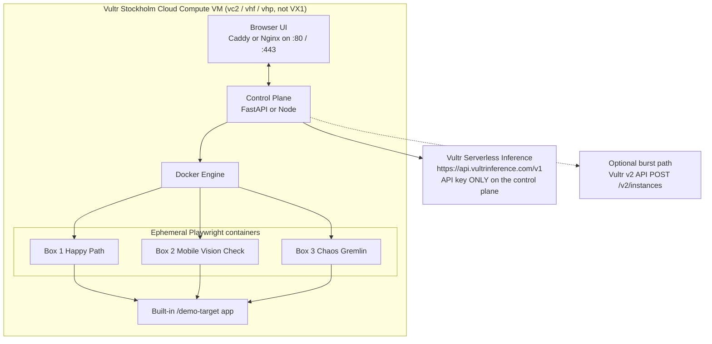

# SafePilot QA

**Untrusted AI code deserves untrusted AI testers in disposable boxes.**

| | |
| --- | --- |
| **Live Demo URL** (hosted on Vultr) | `TODO: paste the public Vultr-hosted URL here` |
| **Recorded Demo Video** (with the live Containment Moment) | `TODO: paste the public video link here` |

The Vultr Community Project Showcases form has no dedicated video field. Put the recorded demo video link in this table and again at the top of the form's Overview field.

---

## What it is

SafePilot QA is a web-based Site QA Sweep agent for the Vultr Agent Runtime Hackathon (Stockholm, 27 November 2026).

Paste any public preview URL, or launch the built-in Adversarial Test App preset. The control plane then:

1. Spawns **3 parallel disposable Playwright Docker sandboxes** on a **Vultr Stockholm Cloud Compute** VM.
2. Uses **Vultr Serverless Inference** to plan browser actions and vision-check screenshots. The inference API key never leaves the control plane.
3. Pauses **Box 1** at checkout with a human **Approve-Before-Submit** gate.
4. Lets **Box 3** hit a hostile page, infinite loop, or prompt injection, then **kills and wipes** that container and shows a live **Containment Receipt**. Boxes 1 and 2 finish untouched.
5. Produces a **DO NOT SHIP** or **SHIP IT** verdict, a red-boxed visual diff screenshot, and a one-click **Copy Fix Prompt for Cursor**.

This is a real product path, not a canned script. Any public URL can be swept. The adversarial preset exists so a judge can see the Containment Moment even without bringing their own broken preview.

## Architecture



Each sandbox is created with hard memory, CPU, PID, and wall-clock caps, a read-only root filesystem, all Linux capabilities dropped, an empty environment (zero secrets), and forced `kill` plus `remove` on exit, timeout, OOM, or prompt-injection detection.

**Infrastructure note:** the live Vultr API has **zero VX1 plans in Stockholm (`sto`)**. The closest VX1 regions are Amsterdam (`ams`), Frankfurt (`fra`), and London (`lhr`). SafePilot QA runs on **Stockholm Cloud Compute + Docker**, which matches the hackathon rules (a Vultr VM and a strict sandbox boundary). An optional control-plane toggle can burst into dedicated throwaway VMs via `POST https://api.vultr.com/v2/instances` when a customer wants full VM-level isolation.

## How we use Vultr

Copy the block below into the Vultr Project Showcases field **"How did you use Vultr?"**.

> SafePilot QA runs entirely on Vultr. The FastAPI control plane and the live dashboard are hosted on a Stockholm Cloud Compute VM (regular `vc2`/`vhf`/`vhp`, because VX1 is not available in `sto`). Each QA run spawns three disposable Playwright Docker containers on that VM with hard CPU, memory, PID, and wall-clock caps, a read-only filesystem, all capabilities dropped, zero secrets inside the sandbox, and automatic destroy/reset after every run or immediately on containment. All planning and screenshot vision checks go through Vultr Serverless Inference at `https://api.vultrinference.com/v1` using the paid multimodal model `qwen3.8-flash-next` (with `glm-5.3-flash` as fallback). The inference API key stays on the control plane only. The same control plane can optionally burst into dedicated throwaway Vultr VMs via `POST /v2/instances` when a customer needs full VM-level isolation.

## The 3-box swarm

| Box | Persona | What it does |
| --- | --- | --- |
| **Box 1 Happy Path** | Desktop buyer | Signs up, adds an item to the cart, and pauses at checkout until a human clicks Approve or Block. |
| **Box 2 Mobile Vision Check** | 390x844 mobile auditor | Captures a mobile screenshot and asks Serverless Inference to return UI bugs with bounding boxes so the dashboard can draw red boxes. |
| **Box 3 Chaos Gremlin** | Adversarial explorer | Probes promo codes, odd clicks, and hostile copy. On the demo target it trips a runaway loop and a prompt-injection payload, then is killed and wiped in about 2 seconds. |

## Quickstart

Full engineering detail is in [`BUILD_SPEC.md`](./BUILD_SPEC.md). Cursor and other coding agents should start with [`AGENTS.md`](./AGENTS.md). Today's submission steps are in [`SUBMISSION_CHECKLIST.md`](./SUBMISSION_CHECKLIST.md).

```bash
# 1. Clone and configure (on the Vultr Stockholm VM, or locally for dev)
git clone https://github.com/mrmetroid/safepilot-qa.git
cd safepilot-qa
cp .env.example .env
# Edit .env and set VULTR_INFERENCE_API_KEY. Never put that key in a container.

# 2. Build the sandbox runner image (no secrets in the build args or image)
docker build -t safepilot-sandbox:latest ./sandbox-runner

# 3. Start the control plane, dashboard, and built-in demo target
#    (exact compose file lands in deploy/ during the build; see BUILD_SPEC.md Section 8)
docker compose -f deploy/docker-compose.yml up --build

# 4. Open the dashboard, click "Load Adversarial Test App (Demo Preset)",
#    approve Box 1's checkout, and watch Box 3 produce a Containment Receipt.
```

Before you call the system ready, confirm all four containment pillars in the UI and in `GET /api/health`: process isolation, secret hygiene (zero API keys in the sandbox), CPU/RAM/time caps, and destroy/reset lifecycle.

## Repository map

This repo is the LLM-ready build specification and the home for the implementation.

| Path | Role |
| --- | --- |
| [`BUILD_SPEC.md`](./BUILD_SPEC.md) | End-to-end engineering spec. Implement from this file. Do not guess around it. |
| [`AGENTS.md`](./AGENTS.md) | Guardrails and recommended implementation order for coding agents. |
| [`SUBMISSION_CHECKLIST.md`](./SUBMISSION_CHECKLIST.md) | Credits, check-in, form fields, demo video script, 19:00 CET deadline. |
| `.env.example` | Control-plane secrets template. Copy to `.env` on the VM only. |

Implementation directories (`backend/`, `sandbox-runner/`, `frontend/`, `demo-target/`, `deploy/`, `docs/`) are defined in Section 7 of the build spec and should be created as the build proceeds.

## Hackathon constraints (short form)

- Event: Vultr Agent Runtime Hackathon, Stockholm, 27 November 2026. Submission cutoff **19:00 CET**.
- The web app and control plane must be hosted on a **Vultr VM**, not on Vercel or other static hosting.
- All agent LLM and vision calls must go to **Vultr Serverless Inference**. Do not call OpenAI, Anthropic, or any other provider.
- Playwright must run **inside disposable Docker containers**, never in-process on the control plane.
- The live demo video must include the **Containment Moment** on Box 3.

## License

Created for the Vultr Agent Runtime Hackathon. Add a SPDX license when the team picks one.
